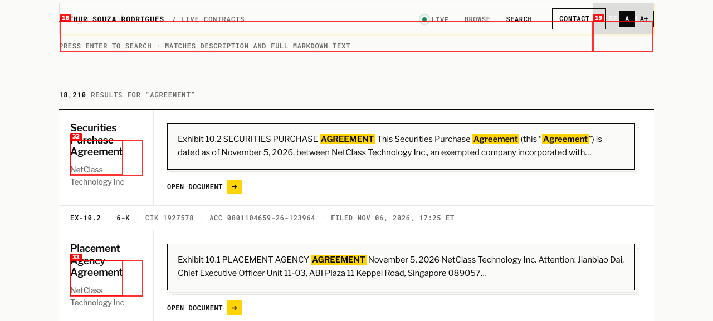
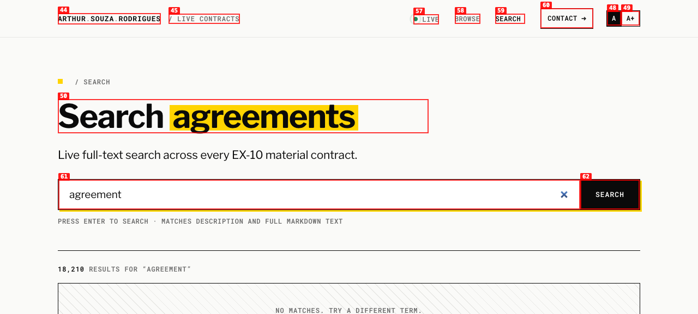
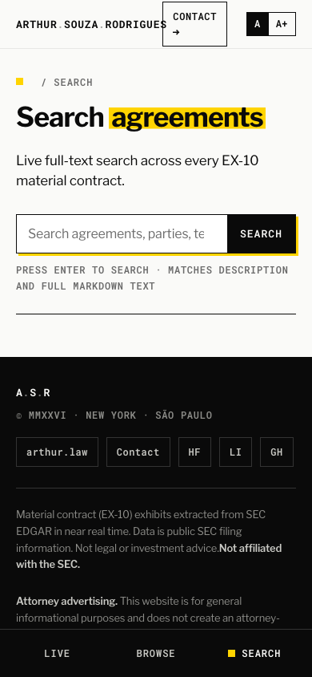

# Dogfood Report: Live Contracts (search after the FTS5 rollout)

| Field | Value |
|-------|-------|
| **Date** | 2026-11-07 |
| **App URL** | https://live-contracts.arthur.law |
| **Session** | lc-fts |
| **Scope** | Search (HTML, phrases, operators, pagination, no results, empty query, mobile); markdown and MCP search via `test/smoke-prod.sh`; regression pass over home, browse, filtered browse and a detail page |

## Summary

| Severity | Count |
|----------|-------|
| Critical | 0 |
| High | 0 |
| Medium | 1 |
| Low | 2 |
| **Total** | **3** |

Search works on every surface. 30 uncached production searches returned 200 in under 0.6 s, highlights render, phrases match as phrases, operators are literal, invalid page numbers fall back to page 1, and no page produced a console error. Home, browse, filtered browse and an agreement detail page reached from a search result all load cleanly.

## Follow-up

- ISSUE-001 fixed in #84 and deployed (`ef340c32`): the title now reads "Amendment to Stock Purchase Agreement".
- ISSUE-002 fixed in #84 and deployed: a page past the end now 302s to the last page.
- ISSUE-003 is the shared header and is left as is.

## Issues

### ISSUE-001: Result title shows a stray markdown escape ("Amendment To\")

| Field | Value |
|-------|-------|
| **Severity** | medium |
| **Category** | content |
| **URL** | https://live-contracts.arthur.law/search?q=agreement |
| **Repro Video** | N/A |

**Description**

The third result's heading and link read `Amendment To\`. The title is lifted from the exhibit's markdown, and the markdown escape character survives into the visible title. The same title appears wherever the card is used, so it is not specific to search, but search surfaces it on the first page for a common term.

**Repro Steps**

1. Open `/search?q=agreement` and look at the third result.
   

---

### ISSUE-002: A page past the end contradicts itself

| Field | Value |
|-------|-------|
| **Severity** | low |
| **Category** | ux |
| **URL** | https://live-contracts.arthur.law/search?q=agreement&page=99999 |
| **Repro Video** | N/A |

**Description**

With a page number beyond the last page, the page shows "18,210 results for agreement", then "No matches. Try a different term.", then a pager reading "99999 / 1518" whose Prev link goes to page 99998. Expected: the last page of results, or a message that the page is out of range with a link back. Reachable through old shared links after the corpus shrinks or by editing the URL.

**Repro Steps**

1. Open `/search?q=agreement&page=99999`.
   

---

### ISSUE-003: Header crowds at 390 px; "CONTACT →" wraps

| Field | Value |
|-------|-------|
| **Severity** | low |
| **Category** | visual |
| **URL** | https://live-contracts.arthur.law/search |
| **Repro Video** | N/A |

**Description**

At a 390 px viewport the header's "CONTACT →" button breaks onto two lines and sits against "ARTHUR.SOUZA.RODRIGUES". This is the shared site header, unchanged by the search work.

**Repro Steps**

1. Open `/search` at 390 × 844.
   

---
