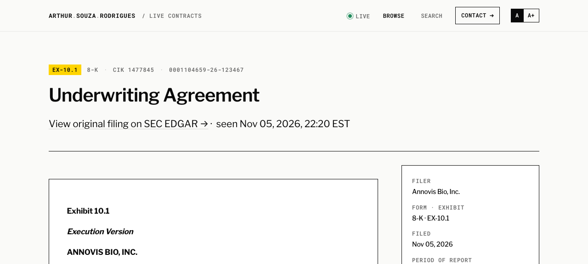
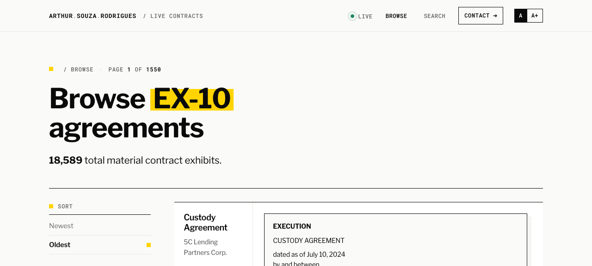

# Dogfood Report: Live Contracts

| Field | Value |
|-------|-------|
| **Date** | 2026-11-06 |
| **App URL** | https://live-contracts.arthur.law |
| **Session** | live-contracts-arthur-law |
| **Scope** | Determine whether the D1 order-by fix is the site that is live. Not a cosmetic audit. |

## Summary

The fix is applied. The hostname serves this app, worker version `9a02cf46-7034-429f-ae68-4b2896920290` at 100%, and the pages that were returning empty HTTP 500s now return the exhibit feed.

| Severity | Count |
|----------|-------|
| Critical | 0 |
| High | 0 |
| Medium | 0 |
| Low | 0 |
| **Total** | **0** |

## What was checked

1. Homepage loaded in the browser. Title `SEC EX-10 Live — Material Contracts`. Hero reads "New material contract exhibits, the moment they hit SEC EDGAR." Stats aside shows 19,329 total agreements and 494 filed in the last 24 hours. The page lists 100 agreement links. Console `errors` exited 0.
   

2. Opened the first card, Underwriting Agreement. Landed on `/agreement/01a1add1-90fa-7e88-858b-33dfc3880dee` with heading "Underwriting Agreement", form 8-K, CIK 1477845, accession `0001104659-26-123467`.
   

3. Opened `/agreements/1?sort=oldest`. Page 1 of 1550. Count reads 18,589 total material contract exhibits. First card is a Custody Agreement for 5C Lending Partners Corp. dated July 10, 2024. That count is 19,329 minus the 740 undated rows the oldest query now skips. Console `errors` exited 0.
   

4. Reloaded the homepage. Title unchanged, 100 agreement links, 19,329 still present.

## HTTP checks before the browser pass

Five homepage requests in a row: HTTP 200, 245,474 bytes, 1.4–2.0s. `/stats.json` HTTP 200, `{"exhibits":19329,"latest_filed_at":"20261105172516",...}`. `/agreements/1` HTTP 200. `/sitemap.xml` HTTP 200, 426,524 bytes.

## Issues

None in this scope. The outage this pass was looking for (empty 500, another project's page on this hostname) did not reproduce.
